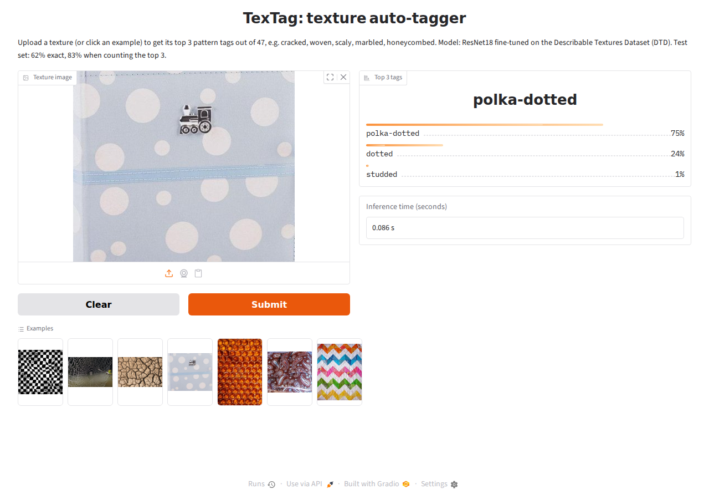

# TexTag: texture auto-tagger for game assets

Upload a texture and TexTag tags it by what it looks like (cracked, woven, scaly, marbled, honeycombed, ...),
with its top 3 guesses and the inference time. A second app searches a whole texture library by tag, by example image,
or (with CLIP) by any words. Built with PyTorch and Gradio.

**Demo:** `python app.py --share` starts the app and prints a temporary public link (`https://….gradio.live`, valid 72 hours). See [Run locally](#run-locally).



## Problem

Texture libraries pile up thousands of files with unhelpful names (`tex_final_v3.png`, `T_Floor_01_D.png`).
Searching them by name only works if someone named them well. TexTag looks at the image itself and tags it,
so textures can be found by what they look like.

- **Type:** multi-class image classifier (1 of 47 texture patterns)
- **Input:** an RGB texture image
- **Output:** top 3 tags with probabilities, plus inference time in seconds
- **Challenge:** many classes look alike (dotted vs polka-dotted, pitted vs porous), and there are only 40 training images per class

## Dataset

[Describable Textures Dataset (DTD)](https://www.robots.ox.ac.uk/~vgg/data/dtd/), loaded with `torchvision.datasets.DTD`:
5,640 images, 47 classes, official partition 1 = 1,880 train / 1,880 validation / 1,880 test (40 per class each).
EDA: perfectly balanced, no corrupted files, all RGB, sizes mostly 300–640 px ([01_eda](notebooks/01_eda.ipynb)).

## Approach

| Step | Notebook / code | What |
|---|---|---|
| 1 | `src/textag/data.py` | `DataLoader`s; augmentation on training images only (random crop, flips, rotation, color jitter); resize 256 → crop 224; ImageNet normalization |
| 2 | [01_eda](notebooks/01_eda.ipynb) | Class balance, sample grid, look-alike classes, image sizes, color stats |
| 3 | [02_baseline](notebooks/02_baseline.ipynb) | **SmallCNN** from scratch: 4 conv blocks + 2 dense layers, 428k weights (VGG-style, an extended TinyVGG) |
| 4 | [03_resnet](notebooks/03_resnet.ipynb) | **ResNet18 transfer learning:** phase 1 trains only a new last layer (frozen backbone), phase 2 fine-tunes all layers with a 10× smaller learning rate |
| 5 | [04_evaluate](notebooks/04_evaluate.ipynb) | Test set: accuracy, top-3, precision/recall/F1, confusion matrix, mistakes |
| 6 | [05_inference](notebooks/05_inference.ipynb), `src/textag/infer.py` | Single-image prediction timed with `time.perf_counter()` |
| 7 | `app.py` | Gradio app: image in → top 3 tags + inference time |
| 8 | [06_clip](notebooks/06_clip.ipynb) | **Model 3, CLIP:** zero-shot (no training) and a linear probe (new last layer on frozen CLIP), plus text search |
| 9 | [07_search](notebooks/07_search.ipynb), `src/textag/multilabel.py` | **Model 4, multi-label:** several tags per image (sigmoid + `BCEWithLogitsLoss`), search index, tag search and find-similar vs CLIP |
| 10 | `search_app.py`, `src/textag/search.py` | Gradio search app: tag, search by tags (or any words with CLIP), find similar; auto re-index of a folder |
| 11 | [08_data_size](notebooks/08_data_size.ipynb) | **Learning curve:** would more labeled data help? Train on 5–40 images per class, extrapolate, cost vs benefit |
| 12 | [09_data_size_smallcnn](notebooks/09_data_size_smallcnn.ipynb) | **Learning curve from scratch:** the same slices with SmallCNN, compared with the pretrained ResNet18 |

**Training setup** (same for every model, so the comparison is fair): `CrossEntropyLoss` (standard for multi-class),
`AdamW` (weight decay 1e-4), batch size 32, `ReduceLROnPlateau` (halve the LR when validation loss stalls for 3 epochs),
early stopping on validation loss (keep the best epoch). Training ran on a Google Colab T4 GPU (`src/textag/engine.py`).

| Hyperparameter | SmallCNN | ResNet18 phase 1 | ResNet18 phase 2 |
|---|---|---|---|
| Learning rate | 1e-3 | 1e-3 | 1e-4 |
| Max epochs / early-stopping patience | 40 / 7 | 15 / 5 | 20 / 5 |
| Dropout | 0.3 | 0.3 | 0.3 |

These are standard defaults rather than a grid search: each run takes ~4–18 minutes on a GPU, and early stopping
plus the LR scheduler tune the number of epochs and the learning rate automatically.

## Results

| Model | Trainable weights | Val accuracy |
|---|---|---|
| Random guessing | – | 2.1% |
| SmallCNN (from scratch, 40 epochs) | 428k | 28.4% |
| ResNet18 phase 1 (feature extractor) | 24k | 56.2% |
| **ResNet18 phase 2 (fine-tuned)** | 11.2M | **62.4%** |
| CLIP ViT-B/32 zero-shot (no training) | 0 | 43.9% |
| CLIP ViT-B/32 linear probe | 24k | 74.2% |

**Final model on the test set** (never used for training or model selection):

| Metric | Test |
|---|---|
| Accuracy | **62.3%** |
| Top-3 accuracy | **82.6%** |
| Macro precision / recall / F1 | 63.4% / 62.3% / 62.0% |
| Inference time (CPU, 2 cores) | ~0.04–0.05 s per image |

**Key findings**

- **Transfer learning more than doubles the from-scratch baseline** (28.4% → 62.4%). With 40 images per class there isn't enough data to learn good filters from scratch.
- **Early stopping mattered:** fine-tuning peaked at epoch 3, then train accuracy climbed to 90% while validation loss rose (overfitting). Early stopping kept the epoch-3 weights.
- **Test ≈ validation** (62.3% vs 62.4%): picking the best epoch on validation didn't inflate the score.
- **Top-3 is 82.6%:** the right tag is among the 3 suggestions 4 times out of 5. Mistakes are usually look-alikes (dotted ↔ polka-dotted is the biggest confusion), so for search and tagging they're still useful results.
- **Best classes** are regular patterns (chequered, freckled, paisley); **worst** are vague ones (blotchy, marbled, bumpy).

**Model 3: CLIP** ([06_clip](notebooks/06_clip.ipynb)). CLIP learned from ~400M images with captions and turns both images and text into 512 numbers.

| CLIP ViT-B/32 | Test accuracy | Test top-3 |
|---|---|---|
| Zero-shot (compare each image with "a cracked texture." etc., no training) | 43.8% | 64.4% |
| Linear probe (new last layer on frozen CLIP, learning rate picked by a small grid search) | **74.1%** | **90.1%** |

- Training only a last layer on frozen CLIP beats fine-tuning all of ResNet18 (74.1% vs 62.3%): what the backbone learned beforehand mattered more than fine-tuning.
- The cost: CLIP's image encoder is ~8× bigger (~350 MB vs 45 MB) and ~3× slower per image on CPU. The app still uses ResNet18.
- CLIP can search with words outside the 47 classes ("rusty metal", "wood planks", "brick wall" find the right textures), the basis for a texture-search tool.

**Model 4: multi-label tags and search** ([07_search](notebooks/07_search.ipynb)). A classifier picks one of 47 classes; search needs a
score for every tag. DTD's second label file (`labels_joint_anno.txt`) lists every tag an image got (~15% of images have 2–4).
Same models, one change: a sigmoid per tag with `BCEWithLogitsLoss` (47 independent yes/no answers) instead of softmax.
The index keeps each image's 47 tag scores and its embedding (the 512 numbers before the last layer).

| Test set | Tagging mAP | Tag search P@10 | Find similar P@10 |
|---|---|---|---|
| Random | – | 2.5% | 3.0% |
| SmallCNN multi-label | 25.1% | 45.7% | 19.6% |
| **ResNet18 multi-label** | **69.7%** | **91.7%** | **58.9%** |
| CLIP ViT-B/32 (zero-shot) | 24.8% | 37.7% | 53.9% |

- **Trained for the task beats bigger and general, on that task:** ResNet18 beats CLIP on DTD's tags (91.7% vs 37.7% tag search) and even on find-similar.
- **Two tags at once** (multiply the scores): 37% of the top 5 have both tags listed, vs 7% for CLIP and 0.7% random.
- **Tagging** with a threshold picked on validation (0.35): precision 70.1%, recall 61.2%.
- **Caveat:** the extra tags are incomplete (most images list one tag even when two fit), so every score is a slight underestimate.
- **Search app:** indexing 1,880 images takes ~62 s on a laptop CPU; searches are then instant. With `--model clip` it finds textures
  outside the 47 tags (a stained-glass image ranks #1 for "stained glass"; a vector honeycomb that ResNet18 can't tag, CLIP tags honeycombed 59%).

**Would more data help?** ([08_data_size](notebooks/08_data_size.ipynb), [09_data_size_smallcnn](notebooks/09_data_size_smallcnn.ipynb)).
The multi-label models trained on slices of the training set (same recipe, every class present), pretrained ResNet18 vs SmallCNN from scratch:

| Training images | ResNet18 mAP / P@10 | SmallCNN mAP / P@10 |
|---|---|---|
| 235 (5 per class) | 44.7% / 69.4% | 5.4% / 8.5% |
| 470 (10) | 53.8% / 80.0% | 9.9% / 17.0% |
| 940 (20) | 58.8% / 83.4% | 16.0% / 30.2% |
| 1,880 (40) | 69.7% / 91.7% | 26.4% / 47.4% |

- **Pretraining does most of the work:** 5 images per class already reach 69% tag-search precision.
- **Still climbing:** about +8 points mAP per doubling; one more doubling (~1,900 labeled images, roughly $190–660 at multi-tag labeling rates\*) should add ~7 points.
- **Further out is a guess:** a power-law fit (each doubling removes ~17% of the remaining error) gives ~80% mAP at 10,000 images. Compute stays cheap
  (~12 min on a T4 for 1,880 images); labels are the real cost.
- **From scratch is far behind:** SmallCNN with all 1,880 images (47.4% P@10) is below ResNet18 with 235 (69.4%).
  Its gains grow with each doubling (+8.5 → +13.2 → +17.2 P@10): it's still in the steep early part of its curve, and still undertrained.
- **Pretraining is worth roughly 74–108× the data:** by a power-law fit, SmallCNN would need ~17,000–25,000 labeled images to match
  ResNet18 trained on 235, about $1,700–8,800 of multi-tag labels\*. A rough extrapolation, ~10× past the measured range.

\* Published labeling prices: ~$0.02–0.10 per image for one tag, up to ~$0.35 for complex multi-label work
([BasicAI benchmark](https://www.basic.ai/blog-post/image-annotation-services-cost), [GigaBPO](https://gigabpo.com/data-labeling-cost-per-image/)).
Estimates; prices vary by provider and change over time.

## What this means for a real tool: specialist vs generalist

**47 DTD patterns aren't what game developers search for.** Real queries mix patterns with materials, objects and styles:
"dog fur", "rusty car paint", "mossy stone", "stained glass", "hand-painted grass". None of those are DTD tags. So the trained models here prove the pipeline
(data → training → evaluation → index → search app), not a vocabulary a game developer could use as is.

| | Specialist (trained on our 47 tags) | Generalist (pretrained: ResNet18 on ImageNet, CLIP) |
|---|---|---|
| Knows | only the 47 texture patterns | general vision: objects, materials, textures, styles |
| Data cost | from scratch: ~17k–25k labeled images just to match ResNet18-on-235, millions to match it fully (09) | already paid by someone else (1.2M ImageNet photos; ~400M image–caption pairs for CLIP) |
| New label ("wood", "dog fur") | label new data and retrain | CLIP: works immediately with any words; ResNet18: a small fine-tune |
| Best at | precision on its own tags (91.7% tag search) | open-ended search (CLIP finds "stained glass" #1) |

**Takeaway: building on an existing model saves most of the cost.** A pretrained generalist has already learned general vision
from millions of images, work someone else paid for. Fine-tuning it on a few hundred labeled images got further here than training
from scratch on all of them. For a real texture tool that suggests CLIP for free-text search, plus a fine-tuned model for the
categories a studio cares about (materials, surface types, art styles), labeled on the textures the tool will actually index.

## Repository

```
app.py                  Gradio app (single-label classifier)
search_app.py           Gradio search app: tag, search, find similar (our multi-label ResNet18, or CLIP with --model clip)
src/textag/             data.py, model.py, engine.py (training loop), infer.py, multilabel.py, search.py
notebooks/              01_eda … 09_data_size_smallcnn (executed, with outputs)
tests/                  smoke tests (pytest)
examples/               example images for the app (from the DTD test set)
scripts/deploy_space.py upload the app to a Hugging Face Space
models/textag.pt        trained weights used by the app (45 MB, produced by 03_resnet)
models/*_multilabel.pt  multi-label weights; textag_multilabel.pt is used by the search app (from 07_search)
```

## Run locally

```bash
python3 -m venv .venv && source .venv/bin/activate
pip install -r requirements.txt
python app.py            # open http://127.0.0.1:7860
python app.py --share    # also prints a public link, valid 72 hours, while the app runs

python search_app.py                           # search app; library = DTD test images
python search_app.py --folder path/to/textures # search your own folder of textures
python search_app.py --model clip              # same app with CLIP: search with any words (port 7861)
```

The search app indexes its library on the first start (every image through the model once, ~2 min for 1,880 images
on a laptop CPU) and saves the index in `data/`, so later starts are instant; images added to a `--folder` later are
indexed at the next search. It also takes `--share`. `--model clip` needs `pip install open_clip_torch` (~600 MB of weights
on first use) and is ~2–3× slower to index.

`requirements.txt` pins the versions used for deployment (Linux, CPU). On an **Intel Mac**, current PyTorch isn't available;
use Python 3.12 and `pip install torch==2.2.2 torchvision==0.17.2 "numpy<2" "gradio>=5" pillow` instead.

**Train:** open `notebooks/02_baseline.ipynb`, `03_resnet.ipynb`, `07_search.ipynb`, `08_data_size.ipynb` or `09_data_size_smallcnn.ipynb` in Google Colab (GPU runtime) and run all; the first cell clones this repo.
**Test:** `pip install -r requirements-dev.txt && pytest -q`

## Deploy

- **Code, notebooks and weights:** this GitHub repository.
- **Public demo:** `python app.py --share` (Gradio share link, 72 hours, while the app runs).
- **Hugging Face Space (optional):** `python scripts/deploy_space.py` uploads `app.py`, `requirements.txt`, `src/textag/`,
  the weights and the examples to a Space (needs `hf auth login` with a write token). Hugging Face now requires a paid plan
  to create Gradio Spaces on its free CPU hardware, so this isn't used for the public demo.

## Limitations

- **Patterns, not materials:** DTD's 47 classes describe patterns (grooved, cracked), not materials (wood, metal, stone).
- **Photos only:** no stylized art (hand-painted, pixel, vector); a flat vector honeycomb gets no tag above 35%.
- **Incomplete tags:** the multi-label file lists only one tag for most images, so the multi-label model is shy about second tags and its scores are underestimates.
- **Data license:** DTD is intended for research use, so the trained model and examples are for demonstration, not commercial use.

## Future work

- **CLIP for open-vocabulary search** (any words, e.g. "mossy stone") alongside the fine-tuned tags; started as the search app's `--model clip`
- **Better labels:** complete the extra tags (e.g. CLIP suggests, a person approves); the learning curve says more labeled data still helps
- **Game-engine plugin** (e.g. Godot): index a project's textures once, then search by content instead of filename; group PBR map sets (base color, normal, roughness, ...) into one material and tag the base color
- Retrain on game-style textures and material classes

## References

- Cimpoi et al. (2014), *Describing Textures in the Wild* (DTD). [arXiv:1311.3618](https://arxiv.org/abs/1311.3618)
- He et al. (2015), *Deep Residual Learning for Image Recognition* (ResNet). [arXiv:1512.03385](https://arxiv.org/abs/1512.03385)
- Yosinski et al. (2014), *How transferable are features in deep neural networks?* [arXiv:1411.1792](https://arxiv.org/abs/1411.1792)
- Simonyan & Zisserman (2014), *Very Deep Convolutional Networks* (VGG). [arXiv:1409.1556](https://arxiv.org/abs/1409.1556)
- Radford et al. (2021), *Learning Transferable Visual Models From Natural Language Supervision* (CLIP). [arXiv:2103.00020](https://arxiv.org/abs/2103.00020)
- BasicAI, *How Much Do Image Annotation Services Cost?* (labeling price benchmark). [basic.ai](https://www.basic.ai/blog-post/image-annotation-services-cost)
- Wang et al., *CNN Explainer* (TinyVGG). [poloclub.github.io/cnn-explainer](https://poloclub.github.io/cnn-explainer/)
